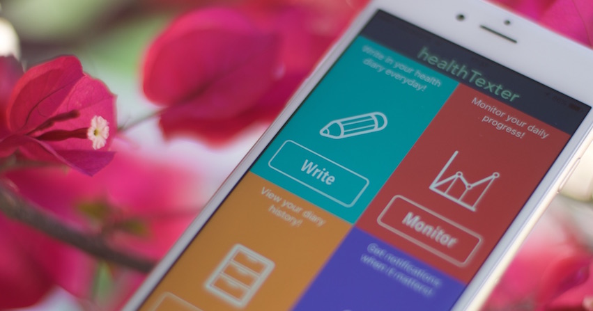
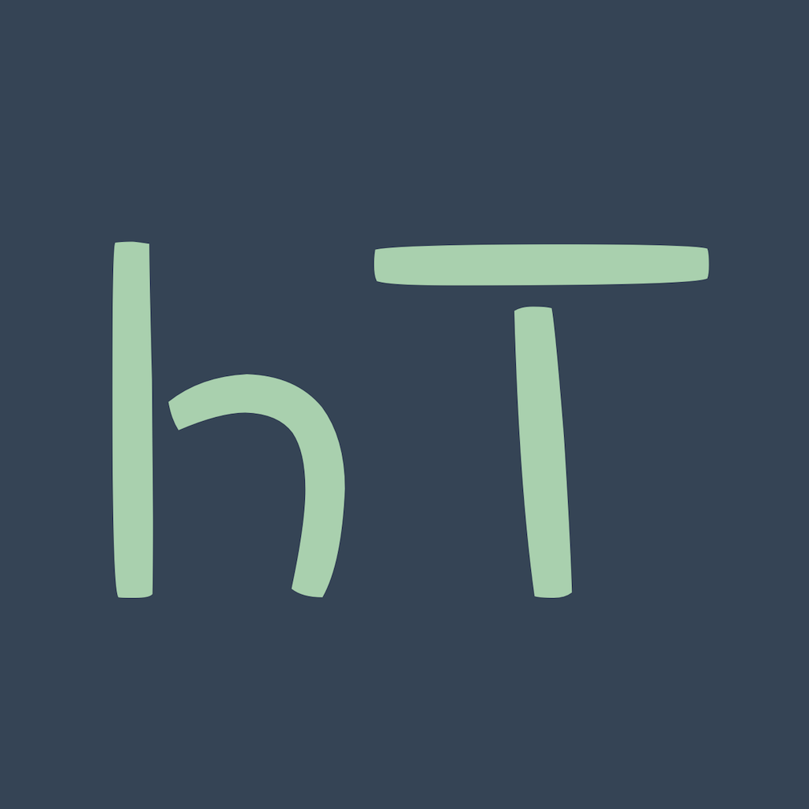
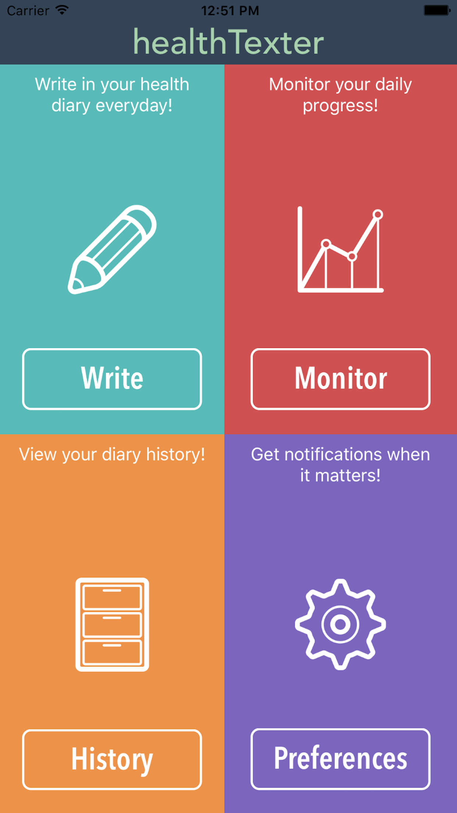
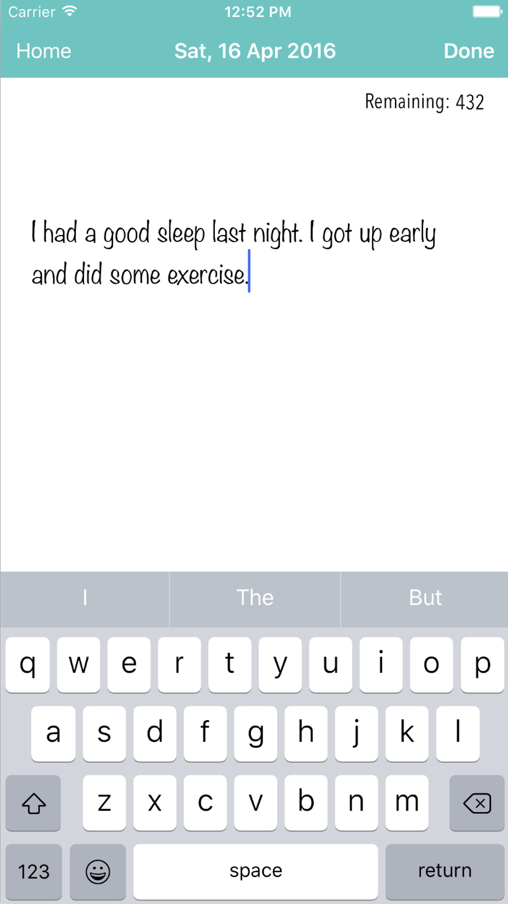
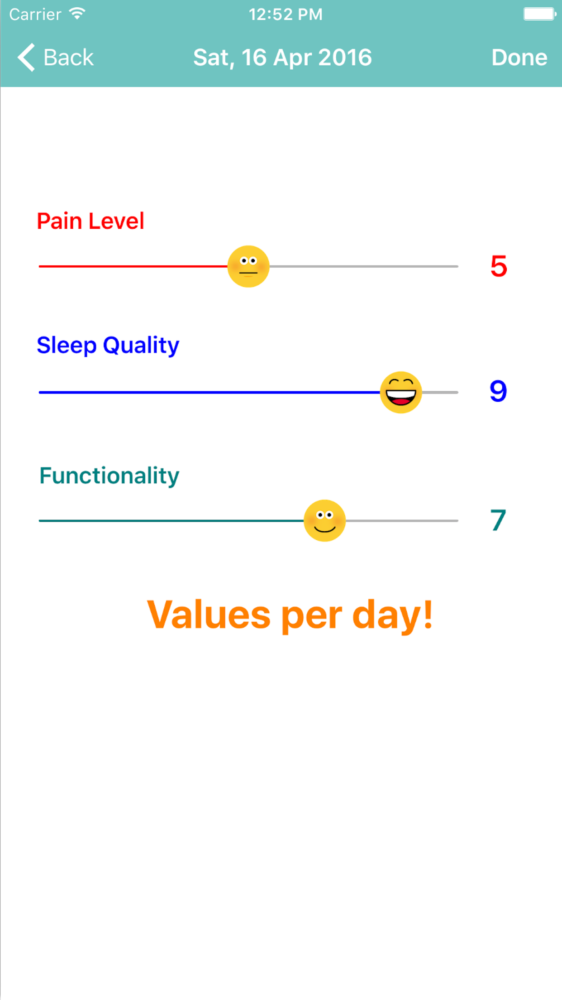
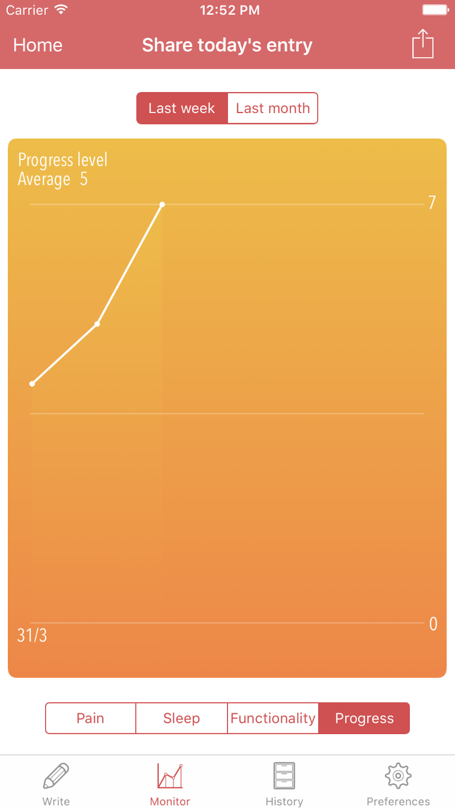
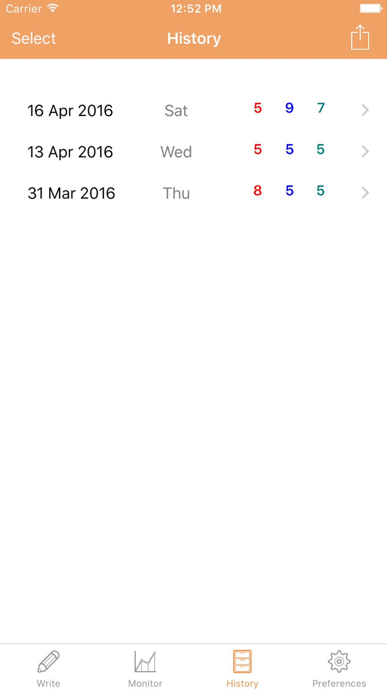

#  healthTexter

An iPhone and iPad health diary for people living with a chronic condition. It helps patients build the habit of writing a daily entry and track their pain, sleep and functionality over time, so they can bring a printout of their diary to their next visit to the doctor.

Published on the App Store as **healthTexter** in April 2016, retired from the store in 2021 and open-sourced here. Over 20 patients took part in user testing. Version 1.0 used In-App Purchases; version 2.0 made every feature free. Together with my other two published apps (RwyXwind and Solution Mix), it reached over 10,000 downloads in total.

  
  
  
  
  

## Features

- Unlimited diary entries
- Daily reminders at the time that suits you
- Dictate entries instead of typing
- A counter of the characters left in each entry
- Daily pain, sleep and functionality values, shown on weekly and monthly charts
- Full history in a table, with the pain, sleep and functionality levels next to each entry
- Share your entries with anyone, or save them to your files
- An adjustable day change time, for people who write after midnight

## Built with

- Swift and Xcode

## Status

No longer maintained. The code is kept here as a record of the app.

## Author

ion-

